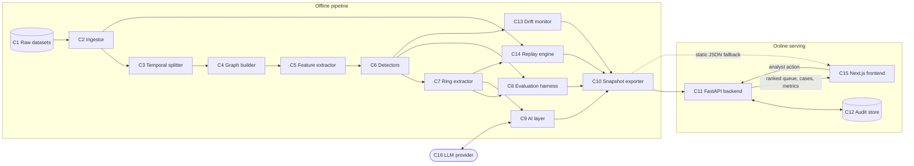

# Architecture

Status at Stage 02: the data side (C1 to C3), the graph builder and feature extractor (C4, C5), baseline detectors and metrics exist. The status column says what is built.

## Principles

- Deterministic core: detection, scoring and verification are ordinary code with fixed seeds.
- The language model is advisory: it writes explanations from structured facts, and every fact it cites is checked against the graph. It never changes a score or takes an action.
- Human gate: nothing is blocked automatically. Analysts confirm, dismiss or hold.
- Offline-first: the frontend works from snapshot JSON when the backend or the model provider is unavailable.
- Defense-only, mainstream dependencies, free tier.
- Variant-agnostic: all data paths derive from one setting (`RS_DATASET_VARIANT`), so HI-Small and HI-Medium run through identical code.

## Components (IDs from the plan)

| ID | Component | Responsibility | Status |
| --- | --- | --- | --- |
| C1 | Raw dataset store | Downloaded datasets (gitignored) plus a committed checksum manifest | Built: `data/raw/MANIFEST.json`, `backend/ringsentinel/ingest/manifest.py` |
| C2 | Ingestor | Normalize raw files to one event table | Built: `backend/ringsentinel/ingest/normalize.py` |
| C3 | Temporal splitter | Train, validation, test by time with no overlap | Built: `backend/ringsentinel/split.py` |
| C4 | Graph builder | Entity graph, hub pruning, IDF weights, communities | Built: `backend/ringsentinel/graph/build.py`, `backend/ringsentinel/graph/hubs.py`, `backend/ringsentinel/graph/communities.py`; derived noise layer `backend/ringsentinel/noise.py` |
| C5 | Feature extractor | Node and community features | Built: `backend/ringsentinel/features/node.py`, `backend/ringsentinel/features/community.py`, `backend/ringsentinel/features/build.py` |
| C6 | Detectors | Velocity rule, tabular XGBoost, graph-feature XGBoost, Isolation Forest | Baselines built: `backend/ringsentinel/models/baselines.py`; graph-feature XGBoost and Isolation Forest Stage 03 [planned] |
| C7 | Ring extractor | Scores to candidate rings | Stage 03 [planned] |
| C8 | Evaluation harness | Metrics, cost model, ablations, robustness, latency | Metrics built: `backend/ringsentinel/evaluation/metrics.py`; the rest Stage 03 [planned] |
| C9 | AI layer | Investigator, verifier, devil's advocate | Stage 06 [planned] |
| C10 | Snapshot exporter | Static JSON bundle with version metadata | Stage 04 [planned] |
| C11 | Backend API | Serves snapshots, accepts analyst actions | Stage 04 [planned] |
| C12 | Audit store | Append-only hash-chained log | Stage 04 [planned] |
| C13 | Drift monitor | Population stability index per window | Stage 07 [planned] |
| C14 | Replay engine | Time-ordered playback with latency | Stage 07 [planned] |
| C15 | Frontend | Queue, case view, metrics, audit, replay | Stage 05 and Stage 07; shell only: `frontend/package.json` |
| C16 | LLM provider | Groq (development), Gemini (production) | Stage 06 [planned] |
| Config | Settings and variant switch | Single source of configuration | Built: `backend/ringsentinel/config.py` |

## Architecture diagram

Caption: the LLM explains evidence; it never changes a score or acts.

## Decisions fixed so far

- Candidate rings are built from real transfer edges, not from derived device or IP attributes. Hub control applies to transfer counterparties; derived attributes are label-blind noise used only to test robustness.
- Every detector outputs a transaction-level score; ring-level metrics use one shared ring extractor.
- Each time window uses a cumulative, past-only graph.
- Ring-level recall is measured against pattern-based rings only; transaction-level metrics use all labels.
- Labels come from the CSV `Is Laundering` column; ring truth comes from the patterns file and covers 3,209 of the 5,177 positives, so 1,968 positives belong to no known ring; see `docs/DATA.md`.
- Test rows are removed before any baseline feature is computed or model is fitted.
- Account identity is the account string alone (banks are not part of the node id).
- Windows are cumulative: val = train + val events, test = all events. Feature rows are the accounts active in the window's own split.
- The hub cap is tuned on the validation window only (smallest cap keeping 99 percent of validation ring accounts); `RS_HUB_CAP` overrides it.
- Hub control = IDF edge weight `1/log2(1+d)` on the larger endpoint degree plus a degree cap. It trims the giant component but does not break it; Louvain splits what remains (igraph implementation).
- Communities are context features, not ring candidates: on the real data they do not recover rings (Stage 02 negative finding). Ring extraction happens after scoring (D8, Stage 03).

The full decision log is in `docs/PROJECT_EXPLAINER.md`.
