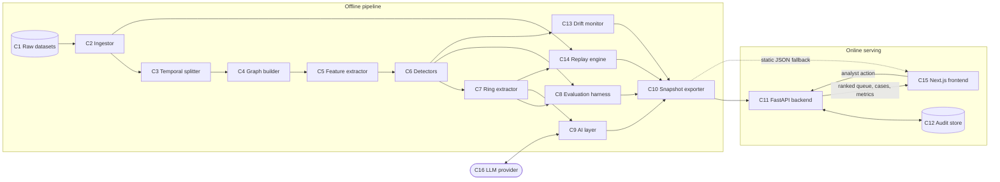

# Architecture

Status at Stage 09 (v1.0.0): every component C1 to C16 is built and has been run on the real HI-Small data and (for the tabular and graph detectors) on Elliptic. Stage 09 adds the Postgres audit store, a database-free liveness route, deployment files and a deployed-site smoke test; none of the three hosting services has been exercised by this tool. The status column below says what is built.

## Principles

- Deterministic core: detection, scoring and verification are ordinary code with fixed seeds.
- The language model is advisory: it writes explanations from structured facts, and every fact it cites is checked against the graph. It never changes a score or takes an action.
- Human gate: nothing is blocked automatically. Analysts confirm, dismiss or hold.
- Offline-first: the frontend works from snapshot JSON when the backend or the model provider is unavailable.
- Defense-only, mainstream dependencies, free tier.
- Variant-agnostic: all data paths derive from one setting (`RS_DATASET_VARIANT`), so HI-Small and HI-Medium run through identical code.

## Components (IDs from the plan)

| ID | Component | Responsibility | Status |
| --- | --- | --- | --- |
| C1 | Raw dataset store | Downloaded datasets (gitignored) plus a committed checksum manifest | Built: `data/raw/MANIFEST.json`, `backend/ringsentinel/ingest/manifest.py` |
| C2 | Ingestor | Normalize raw files to one event table | Built: `backend/ringsentinel/ingest/normalize.py` |
| C3 | Temporal splitter | Train, validation, test by time with no overlap | Built: `backend/ringsentinel/split.py` |
| C4 | Graph builder | Entity graph, hub pruning, IDF weights, communities | Built: `backend/ringsentinel/graph/build.py`, `backend/ringsentinel/graph/hubs.py`, `backend/ringsentinel/graph/communities.py`; derived noise layer `backend/ringsentinel/noise.py` |
| C5 | Feature extractor | Node and community features | Built: `backend/ringsentinel/features/node.py`, `backend/ringsentinel/features/community.py`, `backend/ringsentinel/features/build.py` |
| C6 | Detectors | Velocity rule, tabular XGBoost, graph-feature XGBoost, Isolation Forest | Built (Stage 03): `backend/ringsentinel/detect/tabular.py`, `backend/ringsentinel/detect/matrix.py`, `backend/ringsentinel/detect/models.py`, `backend/ringsentinel/detect/guard.py`; Stage 01 baselines remain in `backend/ringsentinel/models/baselines.py` |
| C7 | Ring extractor | Scores to candidate rings | Built: `backend/ringsentinel/rings/extract.py` |
| C8 | Evaluation harness | Metrics, cost model, ablations, robustness, latency | Built: `backend/ringsentinel/evaluate/metrics.py`, `backend/ringsentinel/evaluate/ringmatch.py`, `backend/ringsentinel/evaluate/cost.py`, `backend/ringsentinel/evaluate/report.py`, orchestration `backend/ringsentinel/stage03.py`; Stage 01 metrics remain in `backend/ringsentinel/evaluation/metrics.py` |
| C9 | AI layer | Investigator, verifier, devil's advocate, template fallback, cache, constrained query | Built (Stage 06): `backend/ringsentinel/ai/pipeline.py`, `backend/ringsentinel/ai/investigator.py`, `backend/ringsentinel/ai/verifier.py`, `backend/ringsentinel/ai/facts.py`, `backend/ringsentinel/ai/tools.py`, `backend/ringsentinel/ai/query.py`, `backend/ringsentinel/ai/cache.py`, `backend/ringsentinel/snapshots/ai_merge.py`, `backend/ringsentinel/stage06.py` |
| C10 | Snapshot exporter | Static JSON bundle with version metadata | Built (Stage 04): `backend/ringsentinel/snapshots/export.py`, `backend/ringsentinel/snapshots/bundle.py`, `backend/ringsentinel/snapshots/schemas.py`, `scripts/export_snapshots.py` |
| C11 | Backend API | Serves snapshots, accepts analyst actions | Built (Stages 04 and 09; Stage 09 adds a liveness route (GET /api/v1/live) and 503 handling for an unreachable audit store): `backend/app/main.py`, `backend/app/routes.py`, `backend/app/ratelimit.py`, `backend/app/config.py`, `backend/app/schemas.py`, `backend/app/store.py` |
| C12 | Audit store | Append-only hash-chained log | Built (Stages 04 and 09): `backend/app/audit.py` (SQLite, the factory `open_audit_log`, shared chain logic), `backend/app/audit_pg.py` (Postgres, for hosts without a persistent disk) |
| C13 | Drift monitor | Population stability index per window | Built (Stage 07): `backend/ringsentinel/monitor/drift.py` |
| C14 | Replay engine | Time-ordered playback with latency | Built (Stage 07, retrospective): `backend/ringsentinel/monitor/replay.py` |
| C15 | Frontend | Queue, case view, decisions, AI panel, metrics, audit, drift, replay | Built (Stages 05 and 07): `frontend/src/lib/source.ts`, `frontend/src/lib/graph.ts`, `frontend/src/lib/metricsView.ts`, `frontend/src/lib/replayView.ts`, `frontend/src/components/QueueView.tsx`, `frontend/src/components/CaseView.tsx`, `frontend/src/components/ActionPanel.tsx`, `frontend/src/components/FeedbackCard.tsx`, `frontend/src/components/DriftView.tsx`, `frontend/src/components/ReplayView.tsx`, `frontend/src/components/MetricsView.tsx`, `frontend/src/components/AuditView.tsx` |
| C16 | LLM provider | Groq (development), Gemini (production), fake (tests) | Built (Stage 06), live calls not yet run: `backend/ringsentinel/ai/provider.py`, `backend/ringsentinel/ai/fake.py` |
| Config | Settings and variant switch | Single source of configuration | Built: `backend/ringsentinel/config.py` |

## Architecture diagram



Caption: the LLM explains evidence; it never changes a score or acts.

## Decisions fixed so far

- Candidate rings are built from real transfer edges, not from derived device or IP attributes. Hub control applies to transfer counterparties; derived attributes are label-blind noise used only to test robustness.
- Every detector outputs a transaction-level score; ring-level metrics use one shared ring extractor.
- Each time window uses a cumulative, past-only graph.
- Ring-level recall is measured against pattern-based rings only; transaction-level metrics use all labels.
- Labels come from the CSV `Is Laundering` column; ring truth comes from the patterns file and covers 3,209 of the 5,177 positives, so 1,968 positives belong to no known ring; see `docs/DATA.md`.
- Test rows are removed before any baseline feature is computed or model is fitted.
- Account identity is the account string alone (banks are not part of the node id).
- Windows are cumulative: val = train + val events, test = all events. Feature rows are the accounts active in the window's own split.
- The hub cap is tuned on the validation window only (smallest cap keeping 99 percent of validation ring accounts); `RS_HUB_CAP` overrides it.
- Hub control = IDF edge weight `1/log2(1+d)` on the larger endpoint degree plus a degree cap. It trims the giant component but does not break it; Louvain splits what remains (igraph implementation).
- Communities are context features, not ring candidates: on the real data they do not recover rings (Stage 02 negative finding). Ring extraction happens after scoring (D8, Stage 03).
- Stage 03: every detector scores each transfer; a transfer uses the graph features of its sender and receiver from the window of its own split. Train fits, validation chooses every threshold, test is scored once per detector (`SplitVault`). Rings come from the flagged transfers (components, then Louvain above the cap); ring match is Jaccard, one-to-one, on pattern rings only. The net-value cost model counts a ring as caught on any illicit hit and charges for legitimate accounts inside flagged rings. Defaults are planning assumptions (INR 250 per review, INR 500 per wrongly included account); see `docs/EVALUATION.md`.

- Stage 04: the bundle is six JSON files validated by JSON Schema and tied together by SHA-256 hashes; the API loads it into memory at start and refuses a bundle that fails any check. Drift, replay and the AI case file are exported as explicit placeholders until Stages 06 and 07. The queue is ranked by an expected-value heuristic that uses the uncalibrated model score. Analyst actions go to a hash-chained SQLite log with idempotency keys; a decided ring is closed.

## Frontend (Stage 05)

A static-export Next.js app. In the browser, `createSource` reads the API if `NEXT_PUBLIC_API_BASE_URL` is set and it answers within the timeout; otherwise it reads the six bundle files from `frontend/public/snapshots` when a local real bundle is available, and if those are absent, from the committed invented demo bundle `frontend/public/demo-snapshots`. Public releases omit the real evaluation bundle pending redistribution review, so the demo bundle is used as the static fallback. The dotted arrow in the diagram above is this fallback. The graph is capped at 500 accounts by a deterministic volume rule (`capGraph`). Details, limits and the open gap (no neighbour nodes in the bundle): `docs/STAGE_05.md`.

## API (Stage 04)

All routes are under the prefix /api/v1. Read routes are open; the action route and the audit list need the X-Analyst-Token header.

```
GET  /health                      bundle id, git commit, counts, whether actions are enabled
GET  /queue?status=&order=&limit=&offset=   rings with status; order=export (bundle rank) or live (feedback-adjusted)
GET  /feedback                    bounded threshold shift and the counts behind it
GET  /cases/{ring_id}             one case: members, edges, top features, ai placeholder, status
GET  /metrics                     Stage 03 metrics, cost sweep, ablations, robustness, latency
GET  /drift                       PSI per time window against the validation scores (placeholder when not built)
GET  /replay                      per-ring detection time and latency, timeline (placeholder when not built)
POST /cases/{ring_id}/action      body: action, analyst, note, idempotency_key   (token)
GET  /audit?limit=&offset=        newest first                                    (token)
GET  /audit/verify                walks the hash chain
```

Status codes: 200 and 201 success (200 with replayed true for a repeated submission), 401 bad or missing token, 404 unknown ring, 409 key reuse for a different request or an action the ring's status does not allow, 422 invalid input, 429 rate limited (Retry-After header), 503 when no analyst token is configured. Request and response details, the audit log design and its limits: `docs/STAGE_04.md`.

The full decision log is in `docs/PROJECT_EXPLAINER.md`.

## Human in the loop, feedback and monitoring (Stage 07)

```
analyst (UI: ActionPanel) -- POST action + token + idempotency key --> C11 API --> C12 audit store (hash chain)
                                                                           |
                       statuses (latest per ring) <-----------------------+
                                  |
                 count confirmed / dismissed
                                  v
     offset = clamp(step * (dismissed - w * confirmed), 0, max)      (hard ceilings in code)
                                  |
     effective threshold = sigmoid(logit(base) + offset)      adjusted score = sigmoid(logit(score) - offset)
                                  v
          GET /queue?order=live  (open rings above the threshold first, by adjusted expected value)

offline export:  scores (val, test) + events --> C13 drift (PSI per window)  --> drift.json  \
                 exported rings + events     --> C14 replay (detection time) --> replay.json  /-> C10 bundle
```
The shift is computed on read from the audit log; no score, rank or detector output is ever rewritten, and the language model has no part in it. Drift compares each equal-width time window of the test period with the validation scores; replay is retrospective. Details and limits: `docs/STAGE_07.md`.

## AI layer (Stage 06)

```
ranked cases (D12) -> CaseFacts (aliases acct-N) -> cache? -> investigator loop (tools, budget) -> verifier
                                                      |            -> devil's advocate -> verifier
                                                      v                         |
                                 template case file (any failure) <-------------+
                                          |
                          ai_cases.json (D10) -> merge_ai_into_bundle -> cases.json `ai` field only
```
The model only explains. It has no access to scores, ranks or actions, and the merge refuses any field except `ai`. Details: `docs/STAGE_06.md`.

## Second dataset and hardening (Stage 08)

The Elliptic path (`backend/ringsentinel/elliptic/`) reuses the same shared pieces as the IBM pipeline: `build_window_features` (graph, hub control), `fit_xgb`, `ImputedIsolationForest`, `SplitVault`, the metric functions and the PSI drift code. It adds a loader, a time-step split, an allow-list of graph columns and an optional plain-PyTorch GraphSAGE. It writes only to data/processed/elliptic and does not touch the snapshot bundle or the API.

API middleware order: rate limit (auth-failure bucket first, client address from `client_address()`), body-size limit, security headers. Details: `docs/STAGE_08.md`.

## Deployment (Stage 09)

```
browser -> Vercel static site (C15, snapshots in frontend/public/snapshots)
        -> Render free web service (C11, serves data/snapshots, RS_API_DOCS=0) -> Neon Postgres (C12)
```

- The API loads the committed snapshot bundle (D12) into memory at start. It needs only `requirements-api.txt`; the modelling stack is not installed on the server.
- The audit log uses `RS_AUDIT_DB_URL`: `sqlite:///...` locally, `postgresql://...` when the disk is not persistent. `backend_of(url)` picks the backend; `open_audit_log(url)` builds it; both stores share `next_entry` and `verify_rows`, so the hash-chain format is identical.
- The Postgres store opens one connection per operation (serverless Postgres drops idle connections) and takes `pg_advisory_xact_lock` on append so two API instances cannot fork the chain. An unreachable database raises `AuditUnavailable`, which the API answers as 503 with `Retry-After: 5`; routes that need only the snapshot (metrics, drift, replay and the liveness route) keep working.
- The liveness route (GET /api/v1/live) never touches the database or the snapshot, so a host health probe cannot wake a scale-to-zero database.
- The frontend falls back API, then `frontend/public/snapshots`, then `frontend/public/demo-snapshots`; a sleeping API therefore degrades the site to read-only, not to an error.
- Steps and troubleshooting: `docs/DEPLOYMENT.md`. Diagrams as regenerable specs: `docs/DIAGRAM_SPECS.md`.
