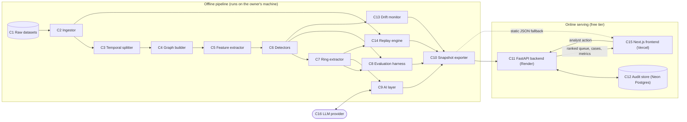
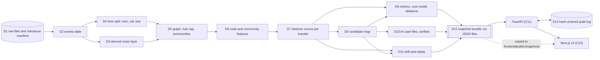
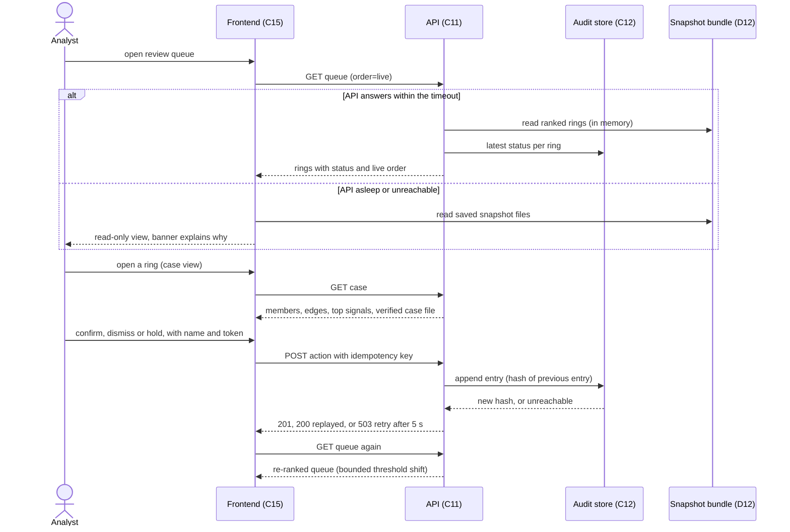

# Diagram specs

Reading this file alone is enough to redraw the three project diagrams in any tool or with any image model. The Mermaid code in each section was rendered successfully with a Mermaid renderer when this file was written (Stage 09). IDs match the component IDs (C1 to C16) in `docs/ARCHITECTURE.md` and the data stage IDs (D1 to D13) in `docs/PROJECT_EXPLAINER.md`.

## Style legend (all three diagrams)

| Element | Rule |
| --- | --- |
| Mode | Light only. White canvas (#FFFFFF), very light grey panels (#F5F7FA) |
| Text | Deep navy, about #0C2451 (approximate; this is an inspiration palette, not an official one) |
| Accent | Blue, about #3395FF, for the main path arrows and the highlighted node (the API) |
| Boxes | Rounded rectangles for processes and components |
| Stores | Cylinder for data that persists (raw files, audit store); double-bordered box for the snapshot bundle (D12) |
| Arrows | Solid = normal data or control flow. Dashed = fallback path, used only when the preferred path is unavailable |
| Groups | Thin grey border, rounded, label in small caps at the top left |
| Font | Inter or the system sans-serif |
| Not allowed | Razorpay logos, marks or colours copied from its brand; no implied affiliation |

## 1. Architecture (components)

Layout direction: left to right. Offline group on the left, online group on the right, LLM provider below the offline group.

| Node | Label | Shape | Group |
| --- | --- | --- | --- |
| C1 | Raw datasets | cylinder | Offline |
| C2 | Ingestor | rounded box | Offline |
| C3 | Temporal splitter | rounded box | Offline |
| C4 | Graph builder | rounded box | Offline |
| C5 | Feature extractor | rounded box | Offline |
| C6 | Detectors | rounded box | Offline |
| C7 | Ring extractor | rounded box | Offline |
| C8 | Evaluation harness | rounded box | Offline |
| C9 | AI layer | rounded box | Offline |
| C10 | Snapshot exporter | rounded box | Offline |
| C13 | Drift monitor | rounded box | Offline |
| C14 | Replay engine | rounded box | Offline |
| C16 | LLM provider | stadium (pill), outside both groups | none |
| C11 | FastAPI backend (Render) | rounded box, blue accent | Online |
| C12 | Audit store (Neon Postgres) | cylinder | Online |
| C15 | Next.js frontend (Vercel) | rounded box | Online |

| Edge | Style | Label |
| --- | --- | --- |
| C1 to C2, C2 to C3, C3 to C4, C4 to C5, C5 to C6 | solid | none |
| C6 to C7, C6 to C8, C7 to C8, C7 to C9 | solid | none |
| C6 to C13, C2 to C14, C7 to C14 | solid | none |
| C8, C9, C13, C14 each to C10 | solid | none |
| C16 and C9 | solid, arrowheads both ends | none |
| C11 and C12 | solid, arrowheads both ends | none |
| C10 to C11 | solid | none |
| C11 to C15 | solid, blue | ranked queue, cases, metrics |
| C10 to C15 | dashed | static JSON fallback |
| C15 to C11 | solid | analyst action |

Caption: An offline, deterministic pipeline turns transaction data into a hash-checked snapshot bundle. A thin API serves the bundle and records analyst decisions in a tamper-evident log, and a static web app shows them, falling back to the saved snapshots when the API is asleep. The language model only explains evidence; it never changes a score or takes an action.

## 2. Data flow (data stages)

Layout direction: left to right, one main row; D12 is the visual centre where three branches merge, then splits to the API and the UI.

| Node | Label | Shape | Produced by |
| --- | --- | --- | --- |
| D1 | raw files and checksum manifest | cylinder | download plus `scripts/inspect_schema.py` |
| D2 | events table | rounded box | C2 |
| D3 | derived noise layer | rounded box | `backend/ringsentinel/noise.py` |
| D4 | time split: train, val, test | rounded box | C3 |
| D5 | graph, hub cap, communities | rounded box | C4 |
| D6 | node and community features | rounded box | C5 |
| D7 | detector scores per transfer | rounded box | C6 |
| D8 | candidate rings | rounded box | C7 |
| D9 | metrics, cost model, ablations | rounded box | C8 |
| D10 | AI case files, verified | rounded box | C9 |
| D11 | drift and replay | rounded box | C13 and C14 |
| D12 | snapshot bundle: six JSON files | double-bordered box | C10 |
| API | FastAPI (C11) | rounded box, blue accent | serving |
| D13 | hash-chained audit log | cylinder | C12 |
| UI | Next.js UI (C15) | rounded box | frontend |

| Edge | Style | Label |
| --- | --- | --- |
| D1 to D2, D2 to D3, D2 to D4, D4 to D5, D3 to D5, D5 to D6, D6 to D7 | solid | none |
| D7 to D8, D7 to D9, D8 to D9, D8 to D10, D7 to D11, D8 to D11 | solid | none |
| D9, D10, D11 each to D12 | solid | none |
| D12 to API, API to UI | solid | none |
| API and D13 | solid, arrowheads both ends | none |
| D12 to UI | dashed | copied to frontend/public/snapshots |

Caption: Each stage reads only the one before it, and time splits are made before any feature is built, so the test period never influences a fitted model or a threshold. Everything the interface shows comes from the single snapshot bundle (D12); the audit log (D13) is the only data the online system writes.

## 3. Analyst sequence

Layout direction: top to bottom, five lifelines left to right: Analyst, Frontend (C15), API (C11), Audit store (C12), Snapshot bundle (D12).

| Item | Detail |
| --- | --- |
| Lifelines | Analyst (person icon), Frontend (C15), API (C11), Audit store (C12), Snapshot bundle (D12) |
| Messages | the 17 arrows in the code, in order; dashed return arrows are responses |
| Grouping | one "alt" frame around the first read: top branch "API answers within the timeout", bottom branch "API asleep or unreachable" |
| Notes to draw | the action message carries a token and an idempotency key; the audit append stores the hash of the previous entry |

Caption: An analyst opens the queue, inspects a ring, and records one of three decisions. The decision is appended to a hash-chained log and the queue is re-ranked by a bounded threshold shift derived from the log. If the API is asleep the same screens work read-only from saved snapshots, and a temporarily unreachable audit database makes a decision fail with a clear retry message rather than losing or forking the log.
